# Orrery

A live solar system as your wallpaper. Every planet sits where it really is, and the spacecraft of the space age fly the paths they really flew. It's all drawn on pure black for OLED screens.

**[The project page](https://fqazzazee.github.io/orrery/)** shows it moving: up close, from afar, and everything between.

[](#install)
[](https://gjs.guide)
[](https://ssd.jpl.nasa.gov)
[](#power-and-oled-care)

[](#install)
[](#install)
[](#install)
[](#other-desktops)
[](https://github.com/fqazzazee/orrery/releases/latest)

[](LICENSE)
[](https://buymeacoffee.com/fqazzazee)

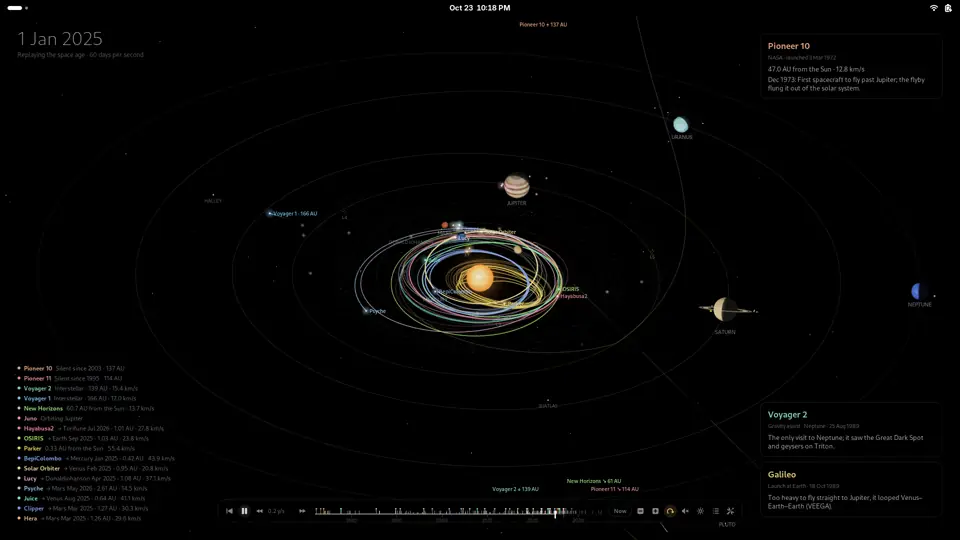

## What it does

An orrery is the old clockwork model of the solar system. This one runs on real astronomy. The planets follow NASA JPL's orbits and turn the way they really face, so Earth's day side matches the time on screen. Forty spacecraft and telescopes, from Mariner 10 in 1973 to Dragonfly on its way to Titan, follow paths fitted to JPL's record of where they went. The ones still flying follow their published plans.

Leave it running and it shows the solar system right now. Or play with it:

- **Click anything** for a card of live facts. It shows how far away it is, how long its light and radio take to reach us, what the trip would take, and trivia about each world.
- **Double-click a planet** to fly in to its moons, satellites and landers.
- **Scroll out** past the Voyagers to the heliopause, the Oort cloud and the nearest stars.
- **Drag the timeline** through sixty years of launches and flybys, and on to the missions still to come.

<table>
  <tr>
    <td width="50%">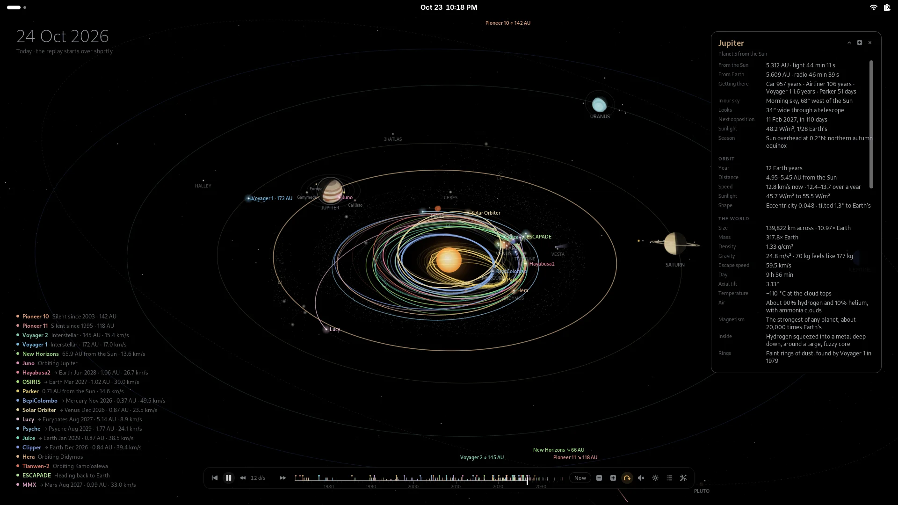</td>
    <td width="50%">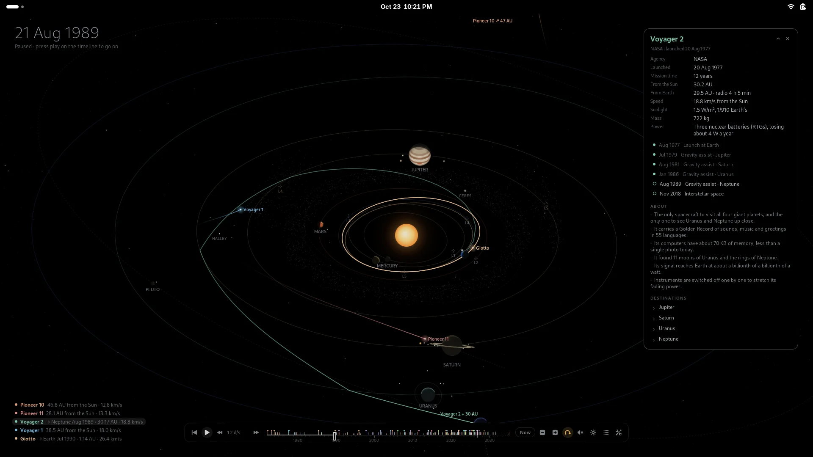</td>
  </tr>
  <tr>
    <td><b>A card for everything.</b> Planets, moons, comets, Lagrange points and spacecraft each have a sheet of live numbers and stories.</td>
    <td><b>Every encounter, one click away.</b> Here is Voyager 2 four days before Neptune, the only visit any spacecraft has made there.</td>
  </tr>
</table>

### Up close

Double-click a planet, scroll the wheel over it, or press the zoom button on its card. The planet fills the screen, with its moons where they really are and the satellites and spacecraft circling it.

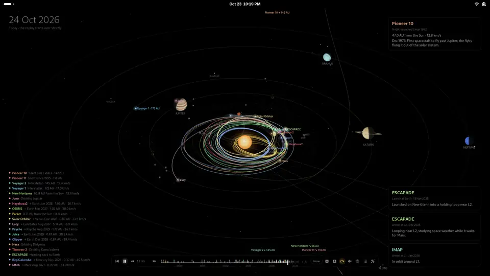

<table>
  <tr>
    <td width="33%">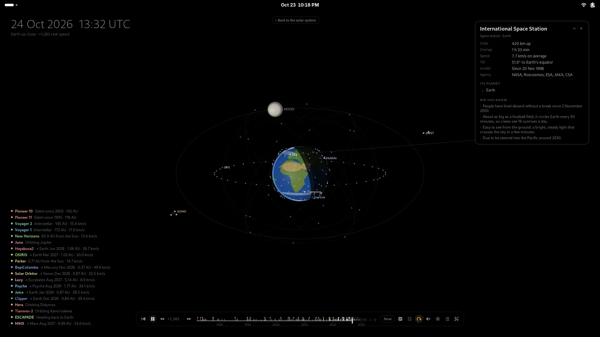</td>
    <td width="33%">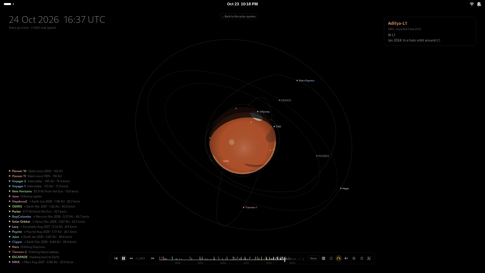</td>
    <td width="33%">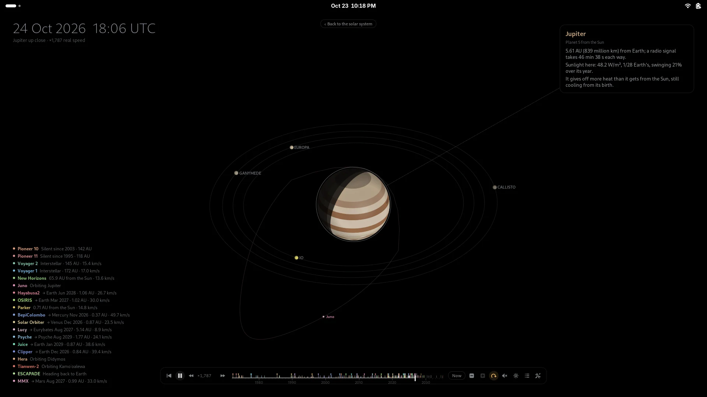</td>
  </tr>
  <tr>
    <td><b>Earth</b>: the ISS, Hubble, GPS, Starlink, the geostationary belt, the Moon, and the telescopes at L1 and L2</td>
    <td><b>Mars</b>: Phobos and Deimos, ten orbiters past and present, and the rovers' landing sites</td>
    <td><b>Jupiter</b>: Io, Europa, Ganymede and Callisto where they really are, and Juno looping over the poles</td>
  </tr>
</table>

### From afar

Scroll down on the desktop to pull back. You pass Neptune and the Kuiper belt, the termination shock and the heliopause, and rings for a light-day, a light-month and a light-year. Then come the Oort cloud's trillions of comets, and Alpha Centauri. The Voyagers, the Pioneers and New Horizons fly out along dashed paths marked with the years they get there, out to 40,000 AD.

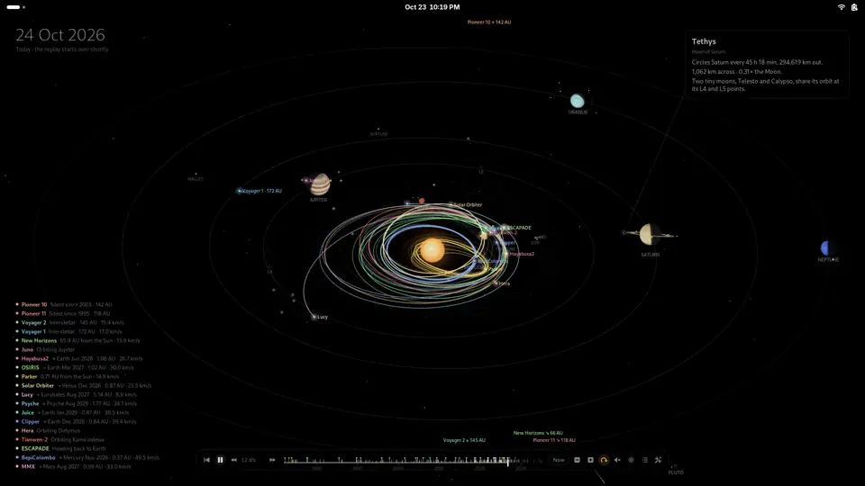

### Everywhere on the desktop

The Activities overview and workspace switches show the solar system, still moving. The timeline's buttons pause and play, change the speed, stop the spin, play music, show and hide things, and open the settings.

<table>
  <tr>
    <td width="50%">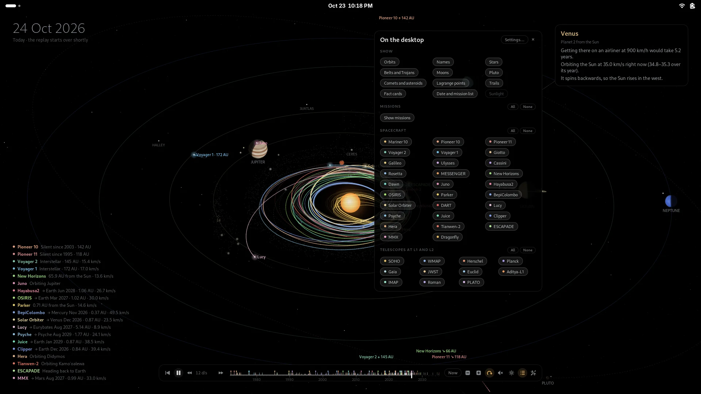</td>
    <td width="50%">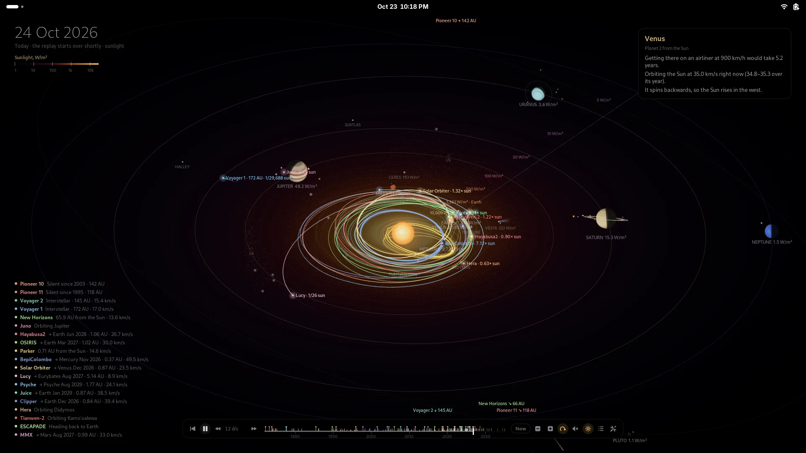</td>
  </tr>
  <tr>
    <td><b>Show and hide</b> orbits, names, moons, trails and every mission, one at a time or all at once.</td>
    <td><b>Sunlight view</b>, from white-hot near the Sun to Neptune's 1.5 W/m². It can follow your charger.</td>
  </tr>
</table>

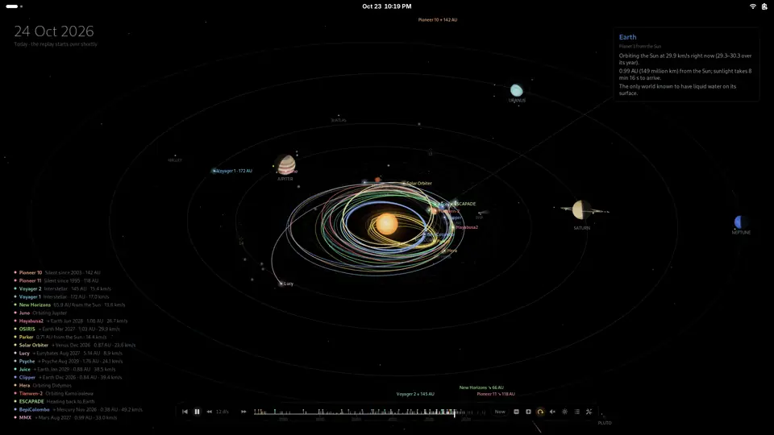

### Everything, in detail

- **Real positions.** Planets sit where they really were (or are) on the date shown, from NASA JPL's orbital elements (good from 1800 to 2050).
- **3D look.** You see the system from an angle. Each planet is a lit sphere with a sharp day/night line, turning on its real axis: Uranus rolls on its side, and Saturn's rings tilt the way they really do.
- **Relative speeds.** Planets orbit at their true relative speeds. They also spin at their true speeds relative to each other, on a slower clock so Jupiter's 10-hour day does not blur.
- **The space age, replayed, and what is coming.**
  - **Flown:** 21 spacecraft fly the gravity assists they really flew, on the real dates: Mariner 10, Pioneer 10 and 11, both Voyagers, Giotto, Galileo, Ulysses, Cassini, Rosetta, MESSENGER, New Horizons, Dawn, Juno, Hayabusa2, OSIRIS-REx/APEX, Parker Solar Probe, BepiColombo, Solar Orbiter, DART and Lucy.
  - **Planned:** missions on their way fly their planned routes into the 2030s: Psyche, Juice, Europa Clipper, Hera, Tianwen-2, ESCAPADE, MMX and Dragonfly.
  - **At L1 and L2:** telescopes and Sun-watchers sit there: SOHO, WMAP, Herschel, Planck, Gaia, JWST, Euclid, Aditya-L1, IMAP, Roman and PLATO.
  - A card pops up at each launch, flyby and arrival.
- **Moons, asteroids, comets and Lagrange points.**
  - The 22 biggest moons circle their planets on a squeezed scale (our Moon at its real phase).
  - Ceres and Vesta have their own orbits.
  - Halley's Comet and the interstellar comet 3I/ATLAS grow tails near the Sun.
  - The asteroids missions visit (Bennu, Ryugu, Apophis, Didymos, the Lucy Trojans, Arrokoth and more) appear while the craft are there.
  - Markers show the Sun–Earth Lagrange points, and a swarm of dots shows Jupiter's Trojans.
- **Fact cards.** Live numbers for the date on screen: distance from the Sun and from Earth, light and radio delay, orbital speed right now, and how long the trip would take by car, airliner or spacecraft. They rotate with trivia about each world.
- **Live mode.** Shows the solar system right now. Voyager 1 is about 172 AU out and nearing one light-day from Earth.
- **Up close.**
  - Double-click a planet, scroll the wheel over it, or press the zoom button on its card to fly in. The planet fills the middle, turned the way it really faces, with its moons where they really are (from JPL Horizons).
  - **Earth:** the ISS, Hubble, Tiangong, the GPS and Starlink constellations and the geostationary belt, with the Moon, L1 and L2 farther out.
  - **Elsewhere:** Mars's orbiters and rovers, Venus's orbiters and Venera landers, Juno at Jupiter, Cassini at Saturn and BepiColombo at Mercury.
  - **Scale:** true near the planet, logarithmic farther out.
  - **Time:** runs at the planet's own pace, a thousand or so times real speed, with the clock in UTC. Pause it and the date holds while the moons and satellites keep circling (as long as the spin is on).
- **From afar.**
  - Scroll the wheel down on the desktop, or use the zoom-out button, to pull back past the planets. You pass the termination shock and the heliopause, rings for one light-day, -week, -month and -year, the Kuiper belt, Sedna and Eris, the inner and outer Oort cloud, and the nearest stars.
  - The Voyagers, the Pioneers and New Horizons fly out along dashed paths marked with the years they get there, out to 40,000 AD.
  - The scale eases to logarithmic as the camera pulls back and rises. The timeline reaches to 2500 and runs in years per second.
- **Interactive.**
  - Point at anything to trace it; click to pin a card that follows it with live numbers. Expand the card for the full, scrolling sheet.
  - **A planet's sheet:** where it is in Earth's sky, its next opposition, its season and how long the trip takes. Then its orbit, gravity, air, magnetism, insides and moons, how it was found and named, who visited, and every bit of trivia.
  - **Moons, comets, asteroids and Lagrange points** have their own sheets; L1 and L2 list the telescopes there.
  - **A spacecraft's card** lists its encounters (clicking one jumps there), its mass and power, what it is known for and where it went.
  - Links in a card open the moon, planet or spacecraft they name.
  - Right-click still opens the usual desktop menu.
- **Timeline.**
  - A scrubber with a tick for every launch, flyby and arrival, out to the planned ones in the 2030s. Drag or scroll it to move through time, and click a tick to jump to that event.
  - **Controls:** play/pause, slower/faster and **Now**. Click the playhead (or middle-click anywhere on the bar) to pause or play. Buttons at the end turn the planets' spin, the music and the sunlight view on and off.
  - **Placement:** top or bottom, centered or in a corner; whatever shares its corner moves aside.
  - It appears when the pointer is on the desktop and fades away after a few seconds.
- **Show and hide from the desktop.**
  - The list button on the timeline opens a panel of chips. The first set covers orbits, names, stars, belts, moons, comets, Lagrange points, trails, fact cards and the sunlight view. Then come chips for every spacecraft and telescope.
  - Each group has **All** and **None**, and a switch hides or shows all missions at once.
  - The gear button (or **Settings…** in the panel) opens the preferences.
- **Music.** The speaker on the timeline plays a slow ambient piece made up as it plays (drifting chords, a low drone, soft bells in long echoes), or your own music from a folder, shuffled. It fades out while windows cover the desktop and stops when the screen locks.
- **In the overview too.** The Activities overview shows the solar system in its workspace cards and, dimmed, behind the app grid; workspaces slide by with it when you switch.
- **Sunlight view.**
  - The ☀ button colors the plane of the planets by how much sunlight falls there, from white-hot near the Sun through Earth's 1,361 W/m² to Neptune's 1.5. It adds labeled contours and the habitable zone.
  - Planets show their sunlight in W/m², and spacecraft as a multiple of Earth's: Parker Solar Probe takes 473 times Earth's sunlight at its closest.
  - It can switch itself on while the charger is connected, or while on battery.

## Status

Stable: [v1.3.1](https://github.com/fqazzazee/orrery/releases/tag/v1.3.1) is the latest release.

- **GNOME:** tested in a real GNOME Shell on 48, 49, 50 and 51, each in a container, both from source and from the installed RPM and DEB packages.
- **Other desktops:** the `orrery-wallpaper` companion's live background is tested in Sway, and its pictures render on Fedora, Debian and Arch.
- **Mission dates:** dates after today are the published plans, and may change.

## Install

From the [latest release](https://github.com/fqazzazee/orrery/releases/latest). Orrery runs on **GNOME 48, 49, 50 and 51**.

```bash
v=1.3.1   # the release's version
url=https://github.com/fqazzazee/orrery/releases/download/v$v
# Fedora, RHEL, openSUSE (zypper install works the same)
sudo dnf install $url/gnome-shell-extension-orrery-$v-1.noarch.rpm
# Debian 13+, Ubuntu 25.04+, Pop!_OS, Mint
curl -LO $url/gnome-shell-extension-orrery_${v}-1_all.deb
sudo apt install ./gnome-shell-extension-orrery_${v}-1_all.deb
# Arch, Manjaro, EndeavourOS
curl -LO $url/gnome-shell-extension-orrery-$v-1-any.pkg.tar.zst
sudo pacman -U gnome-shell-extension-orrery-$v-1-any.pkg.tar.zst
# Any distribution, just for you
curl -LO $url/orrery@fqazzazee.github.io.shell-extension.zip
gnome-extensions install orrery@fqazzazee.github.io.shell-extension.zip
```

Log out and back in, then turn on **Orrery** in Extensions (or `gnome-extensions enable orrery@fqazzazee.github.io`). Settings are in the extension's preferences, or behind the gear on the timeline.

Each release lists its files' SHA-256 sums in `SHA256SUMS`. With it beside your downloads, `sha256sum -c --ignore-missing SHA256SUMS` checks them.

From a checkout, `make link` symlinks it into `~/.local/share/gnome-shell/extensions`.

The scene covers the primary monitor. The overview and workspace switches show live copies of it. If you would rather see your wallpaper there, turn that off under Content › Interaction.

Clicks reach the scene wherever no window covers the desktop. A desktop-icons extension draws a window over the whole desktop, which takes those clicks instead.

### Other desktops

GNOME Shell extensions only run in GNOME Shell. For **KDE Plasma, XFCE, Cinnamon, MATE, Budgie, LXQt, Sway, Hyprland** and the rest, there is `orrery-wallpaper`, in the same three package formats. It draws the same solar system, without the clicking.

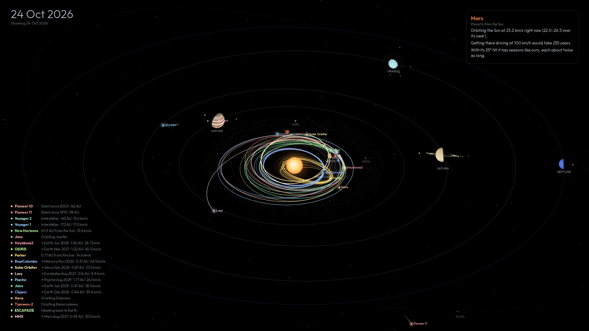

- **A wallpaper that keeps up:** `systemctl --user enable --now orrery-wallpaper` keeps the wallpaper showing the solar system as it is right now, redrawn every 10 minutes.
  - It is set with your desktop's own tool: `plasma-apply-wallpaperimage`, `xfconf-query`, `gsettings`, `swaymsg`, `hyprpaper`, `swaybg` or `feh`.
  - Some desktops do not start systemd's graphical session (XFCE, MATE, LXQt). There, copy `/usr/share/orrery-wallpaper/autostart/orrery-wallpaper.desktop` to `~/.config/autostart/` instead.
- **An animated background:** `systemctl --user enable --now orrery-wallpaper-live` runs one on Wayland compositors with layer-shell (Sway, Hyprland, niri, labwc, river, Wayfire, COSMIC). It needs `gtk4-layer-shell`.
- **One picture:** `orrery-wallpaper render picture.png [--date 1989-08-25] [--size 3840x2160]` draws it. `orrery-wallpaper --help` lists the rest.

## Power and OLED care

- **Stops when hidden:** animation stops whenever the desktop is hidden, by maximized or fullscreen windows, the overview or the lock screen.
- **Little redrawing:**
  - Planets move by translation, not relayout.
  - Each layer only redraws when it changes by most of a pixel.
  - The bands on Jupiter and Saturn are drawn once and reused.
- **True black:** night sides, glows and cards all fade to `#000000`.
- **Pixel shift** slowly drifts the whole scene by a few pixels to spread wear.
- **Pause once windows cover** a set share of the desktop, not only when one is maximized.
- **Battery saver:** on battery or in Power Saver mode, the frame rate drops and the planets stop spinning.
- **Slow down when still:** with time paused and nothing spinning, it runs at 5 frames per second until the pointer moves.
- **Dim after** a few idle minutes: the scene fades to a lower brightness and 10 frames per second. It comes back the moment you move the mouse.
- **Quiet timeline:** it only lights up while you use it.
- **Save more** by lowering **Frames per second** and **Brightness**.

## How the paths are built

**Lambert legs.** Each leg between two encounters is the orbit that joins the two bodies' real positions on those dates (Lambert's problem). The path is exact at every encounter.

**Waypoints.** Some craft fired their engines between encounters: the ion-driven Dawn, Psyche and BepiColombo, or long loops like Ulysses's. For them, waypoints from NASA JPL's Horizons trajectories keep the path to the one the craft really flew. `tools/fit-waypoints.py` compares every mission with Horizons. It adds waypoints until the model stays within 4% of the distance from the Sun.

**Resonant loops.** Some legs leave a planet and return to it after a whole number of its years, like Parker's Venus loops and Galileo's two-year loop. Any orbit with a matching period would fit these, so they use the craft's known number of laps and its perihelion instead.

**Leaving the planets.** The Pioneers and Voyagers head out in their real directions at their real speeds.

**Squeezed distances.** Distances are compressed (square root by default) so that Mercury and Neptune fit on one screen.

## Development

```sh
make test                    # unit tests for the orbital math, every mission path and every card (gjs only)
make test-shell RELEASE=45   # run it in a real GNOME Shell 51 in a container (44: GNOME 50, 43: 49;
                             #   DISTRO=debian RELEASE=trixie: 48), and report any JavaScript error
make dist                    # build the zip and the rpm, deb and Arch packages into dist/ (podman or docker)
tools/fit-waypoints.py [id]  # refit mission waypoints against JPL Horizons (needs network)
```

To release, push a tag like `v1.3.1` that matches `version-name` in `metadata.json`. GitHub Actions then builds every package and publishes them as a release.

The project page lives in [`docs/`](docs). Its screenshots and clips were recorded from the extension itself, running in a headless GNOME Shell.

## Contributing

Bug reports and ideas are welcome in [issues](https://github.com/fqazzazee/orrery/issues). If you want to add a mission, open an issue first, with its JPL Horizons ID if it has one.

## Support

If it made you look up from your work and wonder where Voyager is now, you can [buy me a coffee ☕](https://buymeacoffee.com/fqazzazee).

## License

Orrery is free software under the GPL-2.0-or-later ([`LICENSE`](LICENSE)), as GNOME Shell's own license asks of its extensions.

The planets' orbits come from NASA JPL's approximate orbital elements. The asteroid and comet orbits come from JPL's Small-Body Database. The spacecraft paths are checked against JPL Horizons.
